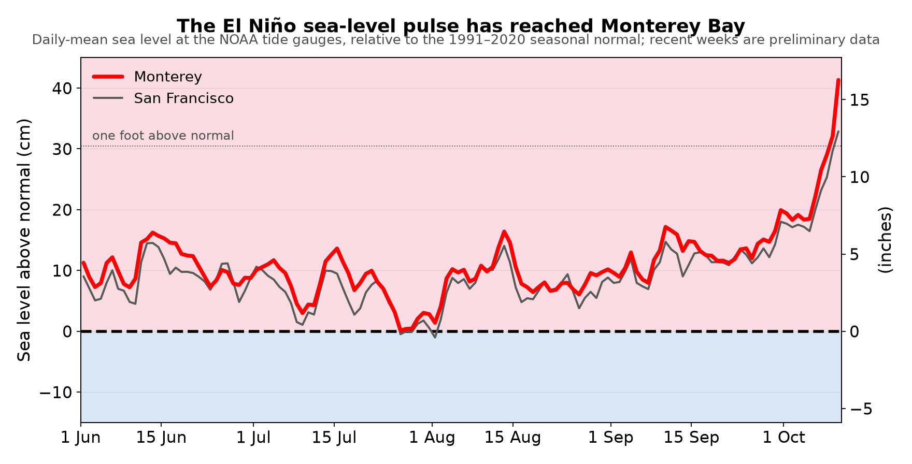

# El Niño, Monterey Bay, and our nearby ocean

### A monthly newsletter from UCSC Ocean Sciences — October 2026

**The 2026–27 El Niño has arrived at our coast. In the first days of October a
pulse of high sea level travelling up from the tropics reached Monterey Bay, the
sea surface in the bay jumped to nearly 3 °C above normal, and NOAA now gives
better-than-even odds that this becomes the strongest El Niño since records began.
The underwater gliders off Monterey Bay show the upper ocean about 2.0 °C
(3.7 °F) warmer than normal — above last spring's peak, and still climbing.**

Since 2007, [Scripps Institution of Oceanography](https://scripps.ucsd.edu/) has
kept [robotic gliders](https://spraydata.ucsd.edu/about/spray-glider) flying a
[line](https://spraydata.ucsd.edu/projects/cugn) that runs from Monterey Bay some
250 miles out to sea. Each glider dives down to 500 m and back up every few hours,
measuring temperature, saltiness and oxygen. At UC Santa Cruz we analyse that
stream of data each month to track how the 2026–27 El Niño is reaching our coast.
Here is where things stand, one month on from our [September
edition](El_Nino_public_Sep2026.md).

## What the gliders see

- **The warmth is past its spring peak — and it runs deep.** The upper ocean off
  Monterey Bay has been [warmer than
  normal](https://spraydata.ucsd.edu/products/cugn-climatology) without a break
  since July 2025. It peaked in April 2026 at 1.9 °C above normal, higher than
  the peak of the big 2015–16 El Niño (1.8 °C), eased a little over the
  summer, and has climbed again since September to 2.0 °C. Close to shore the
  glider's readings in late September and early October ran about 2.5 °C above
  normal. On the most recent full crossing of the line (10 August–10 September),
  the top 100 m averaged 1.2 °C above normal and the water from 100 m
  down to 500 m 0.4 °C — the warmth is pushing the ocean's density layers
  26–44 m deeper than usual.
- **The marine heatwave has flared again, and this time El Niño is part of it.**
  Through the summer, [upwelling](https://oceanservice.noaa.gov/facts/upwelling.html)
  — the wind-driven welling-up of cold water that the gliders
  [map along the whole coast](https://spraydata.ucsd.edu/products/mean-upwelling-circulation) —
  kept a thin cool layer at the surface with the heat sitting just below it. As
  the upwelling season wound down in late September that lid came off. The glider
  logged its warmest reading of the year, 5.0 °C above normal at 10 m depth
  on 3 October, and satellites show the heat reaching the shore: in the week ending
  9 October the sea surface in Monterey Bay itself averaged +2.8 °C above normal
  (it was only +0.4 °C in early September), with +2.0 °C just outside the bay and
  +2.0 °C along the whole 250-mile glider line, and since 3 October the bay has been in a "strong" marine heatwave, 3.5 °C above normal on 9 October. Monterey Bay has
  now spent 162 of the 527 days since May 2025 in [marine-heatwave](https://marineheatwaves.org/)
  conditions. NOAA's [heatwave tracker](https://www.integratedecosystemassessment.noaa.gov/regions/california-current/california-current-marine-heatwave-tracker-blobtracker)
  says that some of the warming off California at the end of September is likely,
  for the first time, "the result of more direct warming due to El Niño drivers".
- **The sea-level pulse has arrived.** The coastal Kelvin wave we flagged last
  month — a pulse of raised sea level travelling up the coast from the tropics —
  reached Central California in the first week of October (Figure 2). [Sea level
  at Monterey](https://tidesandcurrents.noaa.gov/stationhome.html?id=9413450) ran
  about 9 cm above normal in August and 13 cm in September; over the past
  week it has averaged 27 cm (11 in) above normal and reached 41 cm
  (16 in) on 10 October, with San Francisco close behind. Those last
  figures are preliminary, and weather adds to any single day, but the step up is
  unmistakable — and oceanographers expect three or four more such pulses before
  spring.
- **The El Niño itself keeps strengthening.** NOAA's [El Niño
  index](https://www.cpc.ncep.noaa.gov/products/analysis_monitoring/ensostuff/ONI_v5.php)
  now stands at +2.2 °C, up from +1.4 °C a month ago, and the key tropical Pacific
  region reached +2.1 °C in September. In its [8 October update](https://www.cpc.ncep.noaa.gov/products/analysis_monitoring/enso_advisory/ensodisc.shtml)
  NOAA puts the chance of a strong-to-very-strong event lasting through
  March 2027 at 83%, and the chance that October–December is the
  strongest since records began in 1950 at 83%.

**Figure 1.** The excess warmth in the upper ocean off Monterey Bay during two previous warm
periods (yellow, orange) and this year (red), lined up by month starting in July.
This year runs warmer than last year's heatwave (yellow) or the 2014–15
"Blob" (orange) did at the same point in the year — and warmer than any past
El Niño in the twenty-year record. Pink shading is water warmer than
normal, blue cooler; "normal" (0 °C) is the average seasonal cycle for 2008–2013.

**Figure 2.** Daily sea level at the NOAA tide gauges in Monterey (red) and San
Francisco (grey), relative to the normal for the time of year. The El Niño pulse
arrived in early October and lifted the water by roughly a foot; the last few
weeks are preliminary data, and day-to-day weather adds to or subtracts from the
pulse. The dotted line marks one foot (30 cm) above normal.

## What this could mean for the Monterey Bay region

- **Higher water at the coast — starting now.** Strong El Niños raise California sea
  level by up to about a foot for months at a time, and that is what the tide gauges
  are now showing. Stacked on winter storms and high tides (Christmas
  will bring one of the highest tides of the decade), that
  means more coastal flooding and beach and bluff erosion; Scripps researchers
  expect the highest coastal sea levels ever recorded in California this winter.
- **Changes in what lives here.** The past year's heatwave has already brought
  seabird die-offs, warm-water species farther north than usual, renewed stress
  on kelp forests, and — this June — [two humpback whales found dead on Monterey
  Bay beaches](https://news.ucsc.edu/2026/06/dead-whales-domoic-acid/) with the
  algal toxin domoic acid in their systems. A strong El Niño tends to prolong those
  conditions. The last big marine heatwave shows how costly that can be locally:
  during the 2014–16 "Blob" a toxic algal bloom put enough domoic acid into
  Dungeness crab that California delayed the opening of the 2015–16 season until
  late March 2016, and entanglements of whales in fishing gear — about ten a year
  before 2014 — jumped to 53 in 2015 and 55 in 2016 as the warm water squeezed
  whales and the fish they eat into a narrow band near shore
  ([UC Santa Cruz research](https://news.ucsc.edu/2020/01/whale-entanglements/);
  [NOAA Fisheries](https://www.fisheries.noaa.gov/feature-story/looking-back-blob-chapter-2-marine-heat-wave-intensifies-completely-chart)).
- **A leaner ocean.** El Niño weakens upwelling, and with it the nutrients that feed
  the plankton at the base of the food web that supports our salmon, anchovy,
  seabirds and whales. [NOAA's ecosystem
  assessments](https://www.integratedecosystemassessment.noaa.gov/regions/california-current)
  flag reduced productivity as the main ecological risk for 2026–27.
- **Less oxygen at depth.** The gliders also measure dissolved oxygen. Water arriving
  along our coast now carries roughly 35 µmol/kg (17%) less oxygen than usual for
  its density, a little more than last month — a sign that warm, oxygen-poor water
  from the south is being carried northward along the coast. That matters for fish
  and invertebrates that live near the seafloor.

## What we are watching next month

Whether the upper ocean keeps warming past 2 °C above normal as the glider makes
its next full crossing of the line; whether the warm layer keeps deepening; how
high the next sea-level pulses push the November and December king tides; whether
the first winter storms arrive on top of them; and what NOAA's November update
says about the El Niño's peak.

---

*Data: the [California Underwater Glider
Network](https://spraydata.ucsd.edu/projects/cugn) (D. Rudnick, Scripps Institution of
Oceanography, Instrument Development Group), via
[SprayData](https://spraydata.ucsd.edu/) and the
[IOOS Glider Data Assembly Center](https://ioos.github.io/glider-dac/); [NOAA
Climate Prediction
Center](https://www.cpc.ncep.noaa.gov/products/analysis_monitoring/ensostuff/ONI_v5.php)
(El Niño index and forecasts); [NOAA
CO-OPS](https://tidesandcurrents.noaa.gov/stationhome.html?id=9413450) (sea level);
[NOAA OISST](https://www.ncei.noaa.gov/products/optimum-interpolation-sst)
(satellite sea-surface temperature). Analysis: UCSC Ocean Sciences.
Preliminary results, October 2026; updated monthly — next update November 2026.
Scripps also publishes its own
[El Niño glider product](https://spraydata.ucsd.edu/products/el-nino) and
[California climatologies](https://spraydata.ucsd.edu/products/cugn-climatology).
You can also follow what the coastal observing system is seeing on [SCCOOS's El Niño page](https://sccoos.org/el-nino/).*
